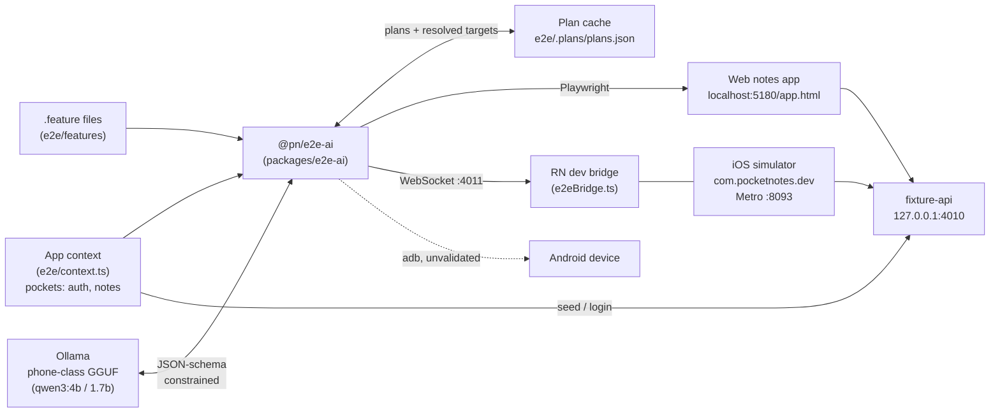
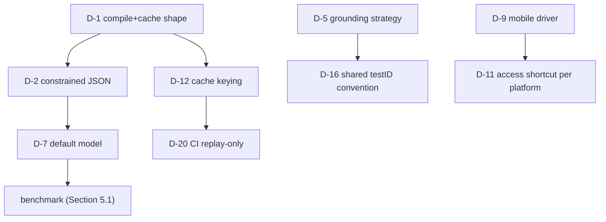
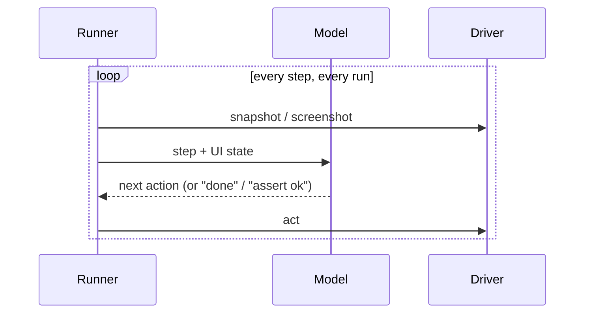
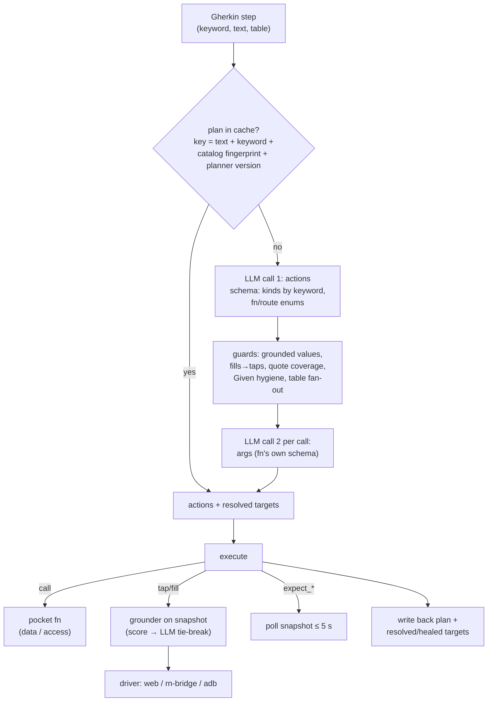
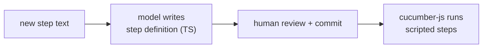
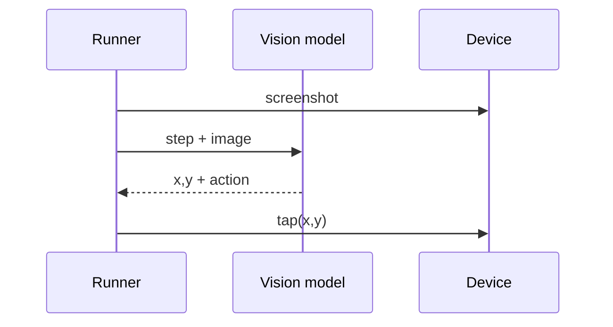
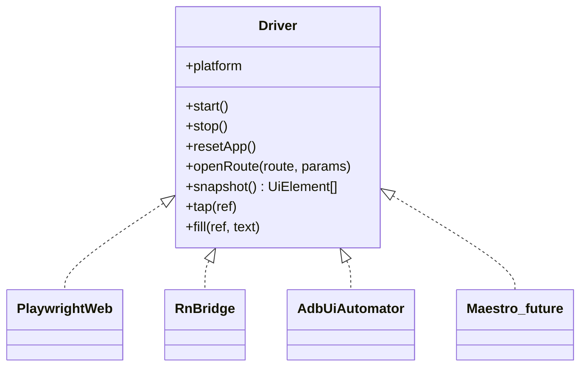
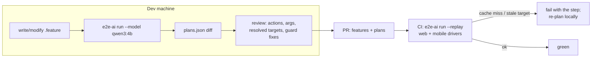

# Investigation: Gherkin-driven E2E for web and mobile, planned by phone-class open models

**Hash:** `79156eed`<br/>
**Date:** 2026-11-18<br/>
**Status:** In Progress<br/>
**Scope:** (Section 12 records the second iteration: docs-only authoring, MCP drivers, routines, templated reports.) Whether a TypeScript tool can run plain-language Cucumber features end to end against a React web app and a React Native app, using an app context ("pockets": data creation, access, routes) and only small open models that fit on a phone to work out data, selectors, actions and assertions. Covers the spike built in this repo (`packages/e2e-ai`, `packages/fixture-api`, `e2e/`, notes screens in `apps/web` and `apps/mobile`) and its measurements. Does not cover running the model on the phone itself, visual (screenshot) testing, or production hardening.

---

## 0. How this investigation was run (assumptions stated, no questions asked)

The developer asked for an unattended spike ("don't ask me anything, just keep building"). The `/investigate` process normally starts with a batch of questions; instead, each question was answered with an explicit assumption, and the spike was built to test the riskiest ones. Every assumption below is used later as `A-n`.

| # | Question the process would have asked | Assumption taken |
|---|---|---|
| A-1 | Who uses the tool? | Developers/QA of the team that owns the apps; they write `.feature` files and maintain one context file per app. |
| A-2 | What are "pockets APIs"? | Small, domain-scoped capability bundles a team hands the tool, as TypeScript objects: data-creation functions, access shortcuts (e.g. "already signed in"), named routes, a glossary, and a few worked examples. The tool may use nothing outside them. |
| A-3 | What does "models that can run on a phone" mean? | Open-weight models of 0.5–4 B parameters whose 4–8-bit GGUF is ≤ 2.5 GB and loads in ≤ ~3 GB RAM. The spike runs them through Ollama on a Mac (same llama.cpp engine and GGUF files `llama.rn` uses on phones); it does not run them on a phone. |
| A-4 | Where does the tool run? | On a developer machine or CI runner, driving a browser, a simulator or a device. The model constraint is about cost, privacy and portability, not about executing tests on the handset. |
| A-5 | What is "an API to create data"? | A test-only HTTP API that seeds state (users, notes) before the UI is touched. The demo app has no backend, so a dev-only fixture API was built. |
| A-6 | Budget / services? | No paid service, no cloud LLM, everything local (matches the repo's zero-running-cost rule). |
| A-7 | Success? | The same feature files pass on web and on mobile; once planned, runs need no model and are deterministic; the planner is ≥ 90 % exact on canonical steps with a phone-class model. |
| A-8 | Ruled-out options? | Cloud models; models > 4 B; closed-weight models. |
| A-9 | Platforms? | Web: Chromium. Mobile: whatever runs on this Mac unattended — iOS simulators were booted; no Android emulator image or cmdline-tools were installed. |

---

## 1. Executive Summary

The spike works. `packages/e2e-ai` parses Cucumber features with the official Gherkin compiler, plans each step with a **phone-class open model (Qwen3 4B, 2.5 GB, or Qwen3 1.7B, 1.4 GB)** through two grammar-constrained JSON calls, grounds UI targets on a live accessibility-style snapshot with deterministic scoring, and executes on Playwright (web) or an in-app bridge (React Native on the iOS simulator). **All 10 scenarios (53 steps) pass on the web and on iOS**; plans produced once on the web replay on iOS and web with **zero model calls** (iOS: 4 s for the whole suite). The recommendation is the "LLM as compiler" shape — the small model only translates prose into a closed action language, deterministic guards check it, and the result is cached as a reviewable lockfile — because small models are fast and good enough at that narrow job, but every failure seen was a *plausible wrong answer*, which only deterministic guards and a reviewed cache catch. **Second iteration (Section 12):** teams now write only `.feature`, `.routine` and Markdown API/app docs plus one config file; the model reaches the apps through MCP driver servers and lays out selectable report templates. 11/11 scenarios pass on web (planned) and iOS (replayed), and qwen3:4b plans 100 % of held-out steps exactly from the docs.

---

## 2. Background & Context

### Current state

- The repo started empty. A small demo product, "Pocket Notes", was set up to test against: a static website (`apps/web`), a bare React Native 0.88 + Expo 58 app (`apps/mobile`, Metro on port **8093**) and their own modules (`core`, `design-tokens`, `i18n`, now in `apps-modules/`).
- There was no app to test and no API, so the spike added:
  - a deliberately small **notes app** on both platforms (sign in → list → add / tick / delete → sign out), with the same `testID`s on web (`data-testid`) and mobile (`testID`): `apps/web/app.html` + `apps/web/src/notes/*`, `apps/mobile/src/screens/{SignInScreen,NotesScreen}.tsx`;
  - **`packages/fixture-api`** (now `apps-modules/fixture-api`): an in-memory HTTP API on `127.0.0.1:4010` (`/auth/login`, `/me`, `/notes`…) plus test-only seeding routes (`/__test/reset`, `/__test/users`, `/__test/notes`) and a typed client;
  - **`packages/e2e-ai`**: the tool (≈1.9 k lines incl. tests and bench);
  - **`e2e/`**: the Pocket Notes app context (two pockets), three feature files, the benchmark set and recorded snapshots.
- Models available locally (pulled for this spike): `qwen3:0.6b`, `qwen3:1.7b`, `qwen3:4b`, `llama3.2:1b`, `llama3.2:3b`, `gemma3:1b`, `smollm2:1.7b`, `lfm2.5-1.2b-instruct`. `gemma4:e2b` was pulled but is a 7.5 GB MLX build here, so it was excluded as not phone-sized in that packaging.

### What triggered it

A wish to describe E2E tests in human language (Gherkin) and let a tool figure out pre-defined data, element selectors, actions and assertions — without writing step definitions — under a hard constraint: only small open models that could run on a phone.

### Cost of inaction

Today every Gherkin step needs a hand-written step definition per platform (Playwright for web, Detox/Maestro/Appium for mobile), with selectors kept in sync with two UIs. That glue code is the part teams stop maintaining, and is why Gherkin suites rot. Large hosted models can do the translation, but at a per-run cost, with test data leaving the machine, and with non-determinism in CI.

### Constraints

- Local-only, open weights, ≤ ~4 B parameters (A-3, A-6).
- Must work on web and mobile from the same features (A-7).
- The tool is a monorepo package (`packages/e2e-ai`), per the request.
- The demo app has no backend; the fixture API is a dev/test-only addition (`apps-modules/fixture-api`), never deployed.

### Current state diagram (what was built)



---

## 3. Problem Space

### Core problem

A Gherkin step is a sentence; an E2E run needs, for each sentence, exact effects: which data to create with which values, which screen to open, which element to touch or type into, and what to check. The mapping depends on the app (its data model, its screens, its vocabulary) and on the current UI state (which elements exist right now). Writing that mapping by hand per step and per platform is expensive and brittle; asking a model to produce it is cheap only if the model is small, and small models are unreliable at exactly the details tests depend on — exact values, exact element, order of actions — while sounding confident.

### Who is affected

| Stakeholder | How they are affected | Stakes |
|---|---|---|
| Feature authors (dev/QA/PO) | Write behaviour in prose; today blocked on step-definition code | Speed of adding coverage |
| App developers | Maintain selectors/step glue for two platforms | Maintenance cost, flaky suites |
| CI | Must be deterministic and offline-capable | Trust in red/green |
| Security/privacy | Test data and screen contents sent to a model | Local small models keep it on the machine |
| Release owners | False passes ship bugs | The worst failure mode of an AI tester |

### Root causes

1. **Natural language is underspecified** relative to UI actions ("sign in as Ana" omits the password; "delete the note" omits which element is the delete control).
2. **App knowledge is not machine-readable**: what data exists, how to create it, how to get a session, what a "note" looks like on screen.
3. **Selectors couple tests to implementation**, and differ per platform.
4. **Small models fail plausibly**: wrong value, wrong order, dropped quote, extra action — output that is well-formed and almost right.
5. **UI is asynchronous**: the right element may not exist yet when a step runs (lists loading after navigation).

### Why now

Phone-class models with reliable structured output (Qwen3 0.6–4 B, Llama 3.2 1–3 B, Gemma 3, SmolLM2, LFM2.5) and grammar-constrained decoding in llama.cpp/Ollama make "a sentence → a JSON action list" feasible in ~0.2 s on a laptop with no cloud. Deferring means keeping hand-written glue or adopting tools that assume a large hosted model.

---

## 4. Scope & Boundaries

### In scope

- Gherkin parsing (Background, Scenario Outline/Examples, data tables, doc strings) and keyword semantics (Given/When/Then, `And` inheriting).
- The app context contract (pockets) and an example for Pocket Notes.
- Step planning with phone-class open models, constrained output, deterministic guards.
- Element grounding on platform-neutral snapshots; assertions; waiting.
- Drivers: web (Playwright), React Native (in-app bridge), Android (adb/uiautomator, written, unvalidated).
- Plan cache (lockfile), self-healing of targets, model-free replay.
- A benchmark of 8 small models, with and without worked examples.

### Out of scope

- Running the planner model on the phone (A-4) — possible via `llama.rn`, not needed for the testing use case.
- Visual/screenshot assertions and vision-language grounding — models that do this well are larger than the constraint (see Option D).
- Generating Gherkin from requirements — the input is human-written features.
- Hardening for many apps (multi-app contexts, auth providers, file uploads, gestures beyond tap/type, scrolling long lists).
- Production use of the fixture API — dev/test only.

### Dependencies

- **Depends on:** Ollama or llama.cpp server locally; `@cucumber/gherkin` 43 / `@cucumber/messages` 35; Playwright 1.63 (Chromium 1243 cached); `ws` 8.23; for mobile, a Debug build with the bridge and Metro on 8093.
- **Depended on by:** future WP specs (`/spec-all`), any team adopting the tool in another repo (via the pocket contract).



---

## 5. Solution Space

### 5.1 What the spike measured

**End-to-end runs** (Pocket Notes, 3 features, 10 scenarios, 53 steps; Apple Silicon Mac):

| Run | Result | Model calls | Wall time |
|---|---|---|---|
| Web, fresh plans (empty cache), qwen3:1.7b | 10/10 | 38–44 calls, 6.1–7.2 s total model time (≈ 0.2 s/step) | ~15 s |
| Web, fresh plans, qwen3:4b (committed `e2e/.plans/plans.json`) | 10/10 (1 step via plan repair) | 42 calls, 19.0 s | ~28 s |
| Web, replay (`--replay`, no model) | 10/10, ×3+ runs | 0 | 8.0 s |
| iOS simulator (RN bridge), replay of plans made on web | 10/10, ×3+ runs (both models' plans) | 0 | 4.0 s |
| iOS simulator, fresh plans | 10/10 with qwen3:1.7b and with qwen3:4b | 42 calls, 6.3 s / 21.5 s | ~15–30 s |

**Planner benchmark** (`npm run e2e:ai:bench`; `e2e/bench/cases.json`: 28 labelled steps — 12 canonical, 16 paraphrases not covered by the examples; grounding scored against recorded snapshots `e2e/bench/snapshots.json`; "exact" = every action kind, function, argument, value, count and grounded `testId` correct; raw results in `e2e/bench/results-20261118.json`):

*Round 1 — all 8 models, guards v3* (`e2e/bench/results-20261118.json`, 28 cases):

| Model (GGUF size) | Examples: exact (canonical / paraphrase) | ms/step | Zero-shot: exact | ms/step |
|---|---|---|---|---|
| qwen3:4b (2.50 GB) | 96 % (92 / 100) | 630 | 86 % | 762 |
| **qwen3:1.7b (1.36 GB)** | **96 % (100 / 94)** | **221** | 61 % | 462 |
| llama3.2:3b (2.02 GB) | 75 % (75 / 75) | 350 | 36 % | 1071 |
| qwen3:0.6b (0.52 GB) | 71 % (58 / 81) | 149 | 36 % | 285 |
| smollm2:1.7b (1.82 GB, Q8) | 61 % (58 / 63) | 366 | 54 % | 621 |
| llama3.2:1b (1.32 GB, Q8) | 54 % (58 / 50) | 484 | 25 % | 706 |
| gemma3:1b (0.81 GB) | 25 % (33 / 19) | 215 | 29 % | 586 |
| lfm2.5-1.2b-instruct (0.73 GB) | 0 % | 844 | 4 % | 816 |

The dominant zero-shot errors were spurious `open` actions ("I sign out" → open a route) and stuttered duplicates (`call,call,call`). Two generic guards were added (G-9 drop `open` when the step has no navigation word, then re-ask with `open` removed from the grammar; G-10 collapse consecutive duplicates).

*Round 2 — same cases, guards v4* (`e2e/bench/results-20261118-guards-v4.json`):

| Model | Examples | Zero-shot |
|---|---|---|
| qwen3:4b | 100 % (630 ms/step) | 100 % (764 ms/step) |
| qwen3:1.7b | 100 % (223 ms/step) | 64 % |
| llama3.2:3b | 86 % | 50 % |
| qwen3:0.6b | 79 % | 50 % |
| smollm2:1.7b | 61 % | 54 % |

Round 2 is optimistic: the guards were written while looking at these cases. **Round 3 is the honest number** — 14 new steps written before running and not used for any change (`e2e/bench/heldout.json`, `results-20261118-heldout.json`):

| Model | Held-out, examples | Held-out, zero-shot | Loaded RAM (8k ctx) |
|---|---|---|---|
| **qwen3:4b** | **100 %** (730 ms/step) | **93 %** | 3.86 GB |
| qwen3:0.6b | 86 % (172 ms/step) | 43 % | 1.56 GB |
| qwen3:1.7b | 79 % (291 ms/step) | 64 % | 2.40 GB |
| llama3.2:3b | 71 % | 36 % (one 9.6 s runaway generation) | 3.09 GB |

Readings: (1) **worked examples in the pockets matter more than model size** below 4 B (qwen3:1.7b: 96 % with, 61 % without, round 1); (2) qwen3:4b is the only model that stays ≥ 93 % on unseen phrasing without examples; (3) n = 14–28 is small — differences under ~10 points (e.g. 0.6b vs 1.7b held-out) are noise; (4) Gemma 3 1B and LFM2.5 are unusable *through this path* — LFM2.5's near-zero suggests a chat-template / structured-output mismatch in Ollama rather than a verdict on the model (not investigated). The remaining held-out misses are recognisable: an extra `call` for a single-item Given, a trailing `tap` duplicated non-consecutively, a value missing its final full stop (still passes as a substring match), and `expect_visible` chosen for "disappears".

*Whole suite with fresh plans per model (web, guards v5):* qwen3:4b 10/10 (one step needed the plan-repair loop, G-11), qwen3:1.7b 10/10, qwen3:0.6b 4/10 (every failure loud, none a false pass).

**Failure modes observed while building** (each became a deterministic guard, see `packages/e2e-ai/src/planner.ts`, `grounder.ts`, `runner.ts`):

| # | What the model did | Effect | Guard |
|---|---|---|---|
| F-1 | Used the `signedInAs` access shortcut for "When I sign in as … with password …" | Login form never exercised | Kinds allowed by keyword are in the **JSON schema**: `When` cannot `call`, `Then` can only `expect_*` |
| F-2 | `tap Sign in` before `fill email`, `fill password` | Submitted an empty form | Fills move ahead of taps within a step |
| F-3 | A stray `tap Add note` inside a `Given` data step | Tapped "Sign in" (role match alone) | Drop UI actions after a setup call in a `Given`; grounding requires ≥ 1 content match, never role alone |
| F-4 | Table rows: row 2 got row 3's title | Wrong data, **test still passed** (count was right) | Tables fan out deterministically: one call per row, columns → params |
| F-5 | `tap "Delete button of note"`, dropped `"Buy milk"` | On iOS (list loads later) grounded to `Add note` | Every quoted value must be used (attached to the first value-less UI action); quoted text is identity — candidates must show it, otherwise keep polling |
| F-6 | (my bug) text assertion matched an input's typed value | "I should see 'Pay rent'" **passed without the note existing** | Only rendered text counts for `expect_visible/hidden` |
| F-7 | Exact-title checkbox outscored the "Delete" button | Ticked instead of deleted | Unquoted words (purpose) outweigh quoted words (identity) |
| F-8 | "Logout button" vs UI "Sign out" | No lexical match | LLM picks among interactive elements by meaning, `"none"` allowed |
| F-9 | Spurious `open` / duplicated actions (benchmark) | Wrong screen, double data | G-9 navigation-word check + re-ask with narrowed grammar; G-10 dedupe |
| F-10 | qwen3:4b dropped the `fill` in "I add a note 'Book dentist'" | Loud failure (quote identity found no element) | G-11 plan-repair loop: one re-plan with the error as feedback, only for freshly planned UI-only steps |
| F-11 | The first repair loop "repaired" a failing **assertion**: "I should see 1 note" re-planned as `expect_count 0` | **A false-pass factory** (it still failed only by luck) | Repair never applies to `Then` steps or plans containing `expect_*` or `call` |

Four of the eleven (F-1, F-4, F-6, F-11) were **false passes or silently weaker tests**, not failures. That is the central risk of the approach (Section 8). The design rule that falls out: the model may help find *how* to do something; it must never be asked to decide *what counts as passing*.

### Option A: Runtime agent (LLM decides every step on every run)

**Description:** Each run, for each step, the model sees the step and the current UI and chooses the next action, possibly looping (observe → act) until it believes the step is done; assertions are model judgements. This is the shape of Midscene.js, Stagehand and Shortest, usually with large hosted or vision models.
**Diagram:**

**Pros:** Handles unexpected UI states (pop-ups, A/B variants) without re-planning; no cache to maintain; can describe goals rather than steps.
**Cons:** Non-deterministic in CI; model cost on every run (local small model: ~0.2–1 s per decision, many decisions per step); assertions judged by a model are where small models are weakest (false passes); reviewers cannot see what will be done before it runs. Published comparisons report AI actions of 1–3 s each and suites an order of magnitude slower than scripted runs.
**Effort:** 2–3 weeks for a robust loop with small models.
**Risk:** Flaky red/green; silent false passes; latency multiplies with suite size.
**When to pick this:** Exploratory testing, smoke-checking apps whose UI the team does not control, or when a large model is available and determinism is not required.

### Option B: Compiler + lockfile (small model plans once, deterministic execution) — built in the spike

**Description:** The model translates each step into a closed action language (`call`, `open`, `tap`, `fill`, `expect_visible`, `expect_hidden`, `expect_count`) using only names from the pockets (enums in the JSON schema). Deterministic guards repair known small-model errors. The runner grounds targets on the live snapshot (lexical scoring; the model only breaks ties or maps synonyms, from a short, constrained list), executes, and stores the plan plus each platform's resolved element in `e2e/.plans/plans.json`. Later runs replay with no model; a target that no longer matches is re-grounded and the change is written back (and visible in the diff).
**Diagram:**

**Pros:** Deterministic CI (replay, `--replay` fails on a cache miss); ~0.2 s per step to plan, 0 afterwards; plans are reviewable JSON; one plan serves web and mobile (targets resolved per platform); tiny models suffice because each decision is small and constrained; guards catch the observed failure modes.
**Cons:** A wrong plan that passes is cached and replayed until someone reads the diff; prose that needs app knowledge beyond the pockets fails; adding a new kind of interaction (swipe, scroll, date picker) means extending the action language, the drivers and the guards; the cache must be invalidated correctly (catalog fingerprint + `PLANNER_VERSION`).
**Effort:** Spike: ~1 day. Production-ready for one team: 3–5 weeks (Section 9).
**Risk:** Plan review discipline; heuristics (fills-before-taps) that are wrong for some flows; grounding drift on look-alike elements.
**When to pick this:** The target here: owned apps, CI determinism required, phone-class models only.

### Option C: Generate step-definition code with the model (authoring-time codegen)

**Description:** At authoring time the model writes TypeScript step definitions (cucumber-js + Playwright / Detox) for each new step pattern; humans review and commit the code; no model runs in CI.
**Diagram:**

**Pros:** Fully conventional at runtime; reviewers read code they already understand; no custom runner.
**Cons:** Small models are much worse at writing correct code (selectors, async waits, platform APIs) than at filling a JSON schema; two platforms → two code paths per step; regenerating after UI changes is manual; the code reintroduces exactly the selector maintenance the initiative wants to remove.
**Effort:** 1–2 weeks for the generator; ongoing review cost per step.
**Risk:** Generated code compiles but waits wrongly (flake), and it is reviewed less carefully than the team thinks.
**When to pick this:** Teams that must stay on plain cucumber-js, or that use a large model for authoring.

### Option D: Vision-language grounding (screenshots instead of accessibility snapshots)

**Description:** Ground targets from screenshots with a VLM (e.g. UI-TARS, Qwen-VL class), clicking coordinates. Useful when the UI has no accessibility tree (canvas, games, WebViews).
**Diagram:**

**Pros:** Works without testIDs/labels; catches visual issues; platform-agnostic.
**Cons:** Capable GUI-grounding VLMs are mostly ≥ 3–7 B plus a vision encoder (outside the phone-class constraint as packaged — e.g. `gemma4:e2b` is 7.5 GB here); slower (image tokens); coordinates are not replayable across devices/resolutions; pushes teams away from accessibility.
**Effort:** 2–4 weeks; model evaluation dominates.
**Risk:** Breaks A-3; nondeterminism.
**When to pick this:** Later, as a fallback grounder for elements with no accessible name, not as the main path. (Assumption: VLM sizes per general knowledge as of 2026; not benchmarked here.)

### Option M: Mobile driver choices (orthogonal to A–D)

| Driver | Kind | Status in spike | Pros | Cons |
|---|---|---|---|---|
| **RN bridge** (`apps/mobile/src/testing/e2eBridge.ts` + `drivers/rnBridge.ts`) | Gray-box: fiber tree snapshot; calls `onPress`/`onChangeText` | **Working on iOS sim, 10/10** | No installs, both platforms, fast (4 s suite), sees testID/role/label/text | Not real touches (misses hit-testing, overlays, keyboard); depends on React internals (`_reactInternals`, fiber tags 5/6); Debug builds only |
| **adb + uiautomator** (`drivers/adb.ts`) | Black-box Android | Written + unit-tested parser, **not run on a device** (no emulator image installed) | Real touches, zero installs beyond platform-tools; RN maps `testID`→`resource-id` | Android only; `uiautomator dump` is slow (~1–2 s); text input escaping |
| **Maestro** | Black-box iOS+Android | Not tried: the installer (`curl … | bash`) was blocked by the session's permission policy | Real touches both platforms, has `hierarchy` and an MCP server | Needs Java + install approval; per-command JVM start-up unless driven via its MCP/daemon |
| **Appium (XCUITest/UiAutomator2)** | Black-box | Not tried | Industry standard, real touches | Heavy setup (WebDriverAgent build), slow |
| **Detox** | Gray-box (synchronises with RN) | Not tried | Automatic idle sync, real taps | Build config per app; more invasive |

**Diagram (driver contract all of them implement):**


---

## 6. Key Decisions

| # | Decision | Options Considered | Status | Chosen / Leaning | Rationale | Reversible? |
|---|---|---|---|---|---|---|
| D-1 | Overall shape | A runtime agent, B compiler+lockfile, C codegen, D VLM | Resolved | **B** | Determinism in CI, tiny per-step model job, reviewable plans; measured 10/10 web+iOS, replay with 0 model calls | Yes (planner is behind `Llm`) |
| D-2 | How model output is controlled | free text + parse; native tool calling; JSON-schema grammar | Resolved | **JSON schema via Ollama `format`** (llama.cpp grammar) | Small models cannot emit invalid shapes; enums restrict `fn`/`route` to the catalog; same mechanism exists on-device (`llama.rn` JSON-schema → GBNF) | Yes |
| D-3 | One call vs staged calls | single big schema; actions then args | Resolved | **Two stages**: actions, then each `call`'s own param schema | Per-function schemas give exact types/enums; smaller prompts | Yes |
| D-4 | Action language | open-ended; 7 closed kinds | Resolved (for spike) | `call, open, tap, fill, expect_visible, expect_hidden, expect_count` | Enough for the notes app; every kind has a guard. Missing: checked state, scroll, swipe, select, wait-for | Yes, additive |
| D-5 | Grounding | LLM picks from whole snapshot; selectors in pockets; **lexical score + LLM tie-break/synonyms** | Resolved | Lexical first; LLM only on ambiguity (≥ 2 within 1.5 points) or no lexical match, from ≤ 8–12 enum choices with `"none"` | Keeps the model's job tiny and checkable; F-7/F-8 fixed this way | Yes |
| D-6 | What the model "sees" | screenshot; full DOM; **a11y-flattened list** (role, name, text, testId, placeholder, checked) | Resolved | Flattened list, same shape on web and RN | Fits a 1 B model's context; platform-neutral | Yes |
| D-7 | Default model | 8 candidates (Section 5.1) | Resolved (provisional) | **qwen3:4b** (Apache-2.0, 2.5 GB Q4_K_M); **qwen3:1.7b** as the low-memory option | Planning happens once per new step and is cached, so accuracy matters more than the 3× latency: 4b is the only model ≥ 93 % on held-out steps with and without examples. 4b needs ~3.9 GB loaded at 8k context (8 GB-RAM phones only); 1.7b (2.4 GB) fits most phones and passed the whole suite 10/10 but scored 79 % held-out | Yes (`--model`, `E2E_MODEL`) |
| D-8 | Model runtime | Ollama; llama.cpp server; in-process node-llama-cpp; on-device llama.rn | Resolved (dev), Open (CI) | Ollama locally | Already installed; CI image choice open (Q-3) | Yes |
| D-9 | Mobile driver | RN bridge, adb, Maestro, Appium, Detox | **Open** | RN bridge for now; add a black-box driver before relying on mobile results | Bridge proved the contract; black-box needed for touch-level truth. Blocked on: install approval for Maestro / an Android emulator image | Yes |
| D-10 | Data creation contract | raw HTTP in features; DB fixtures; **pocket functions over test-only routes** | Resolved | Pocket `data` fns calling `/__test/*` via a typed client | The model sees names + param descriptions, never URLs | Yes |
| D-11 | Access (getting a session) | always via UI; **`access` pocket fn + route param** | Resolved | `auth.signedInAs` logs in via API and opens route `notes` with `session` (web: `?session=`; mobile: bridge `openRoute`) | Fast Background setup while sign-in features still exercise the form (F-1 guard) | Yes |
| D-12 | Cache key & invalidation | text only; + model; **text + keyword + catalog fingerprint + `PLANNER_VERSION`** | Resolved | As chosen; resolved targets keyed per platform (`web:` / `mobile:`) | Model changes alone do not invalidate (plans are reviewed artefacts); guard changes do | Yes |
| D-13 | Commit the plan cache? | ignore; **commit and review** | Leaning | Commit `e2e/.plans/plans.json` | It is the reviewable truth of what runs; heals show as diffs. Owner: adopting team | Yes |
| D-14 | Where the tool lives | separate repo; **monorepo package** | Resolved | `packages/e2e-ai` (`@pn/e2e-ai`), source-only TS run by Node 22 type stripping | Requested; publishable later | Yes |
| D-15 | Guards domain-agnostic? | app-specific rules; **generic rules only** | Resolved | All 8 guards are generic (no notes-specific logic) | Must transfer to other apps | — |
| D-16 | Element identity across platforms | per-platform selectors; **shared testID convention** | Resolved | `signin-email`, `notes-add`, `note-row-<id>`… on both | Lets one plan replay on both; list rows grouped by stripping the id suffix | Yes |
| D-17 | Fixture API vs "no backend" rule | mock in-app; MSW; **dev-only local API** | Resolved | `packages/fixture-api`, 127.0.0.1 only, never deployed; exception recorded in `CLAUDE.md` | The request needs an API to create data | Yes |
| D-18 | What "I should see X" means | any text incl. input values; **rendered text only** | Resolved | Inputs excluded | F-6 false pass | Yes |
| D-19 | Quoted text semantics | hint; **identity** | Resolved | A quoted value must be shown by the grounded element (except for `fill` values) | F-5 race; makes waiting correct | Yes |
| D-20 | CI mode | plan in CI; **replay-only, fail on cache miss** | Leaning | `--replay` in CI; planning happens on dev machines and is committed | Determinism; no model in CI unless the team opts in | Yes |
| D-21 | Few-shot examples in pockets | none; **a few per pocket, phrased unlike the features** | Resolved | 6 examples in `e2e/context.ts` | Benchmark shows their effect (Section 5.1) | Yes |
| D-22 | Step ordering heuristic | trust the model; **fills before taps** | Resolved (with caveat) | Applied within a step | Fixed F-2 every time; wrong for "tap a field to reveal another field, then type" (Q-5) | Yes |
| D-23 | Retry when a fresh plan fails | none; retry everything; **one re-plan for UI-only, non-assertion steps** | Resolved | G-11 as chosen | Fixed F-10; F-11 showed retrying assertions turns the model into the judge | Yes |
| D-24 | Narrowing the grammar on retry | prompt-only correction; **remove the offending kind from the schema enum and re-ask** | Resolved | Used for spurious `open` (G-9) | Small models ignore prompt corrections but cannot violate an enum | Yes |

**Open decisions**

- **D-9 Mobile driver.** Needs: approval to install Maestro (or Android cmdline-tools + a system image), then run the same features through it and compare with the bridge. Owner: the developer. Deadline: before mobile results gate a release.
- **D-13 / D-20 Cache in git + replay-only CI.** Needs: one sprint of real use to see how noisy heal diffs are. Owner: the adopting team's tech lead.
- **D-7 (provisional).** Needs: the benchmark extended with the team's own steps (≥ 100 real steps) and a phone-side latency check if on-device planning is ever wanted. Owner: whoever runs `npm run e2e:ai:bench`.

---

## 7. Trade-offs

| Area | What we gain | What we give up | Net verdict |
|---|---|---|---|
| Determinism | Replays are model-free and repeatable (10/10 ×3 on both platforms) | A wrong-but-passing plan is replayed until reviewed | Acceptable, with mandatory plan review |
| Performance | 0.2–0.7 s/step planning (1.7 B / 4 B); 0 s on replay; iOS suite 4 s | First run per new step needs a loaded model (2.4–3.9 GB RAM at 8k context) | Acceptable |
| Model size | Runs anywhere, offline, private, free | Paraphrase robustness lower than large models; needs guards and examples | Acceptable |
| Complexity | Generic guards turn plausible errors into repairs or failures | ~1.9 k lines of heuristics to own; each new interaction type needs schema + driver + guard work | Acceptable for one team; review before generalising |
| Flexibility | Same features, same plans, web and mobile | Closed action language; no gestures/scroll/visual checks yet | Acceptable for CRUD-style apps |
| Fidelity (mobile) | Bridge needs no tooling and is fast | Not real touches; React-internals dependency; Debug builds only | Unacceptable as the only mobile driver for release gating → D-9 |
| Speed to ship | Spike in a day; small surface | Production hardening 3–5 weeks | Acceptable |
| Operational burden | No services, no keys, no cloud | Teams maintain pockets (data fns, routes, glossary, examples) | Acceptable — this is the "app knowledge" that has to live somewhere |

---

## 8. Challenges & Risks

| Challenge | Likelihood | Impact | Mitigation Strategy |
|---|---|---|---|
| **False passes** (wrong plan that passes: F-1, F-4, F-6) | High | High | Generic guards (keyword grammar, grounded values, quote coverage, table fan-out, rendered-text assertions); commit plans and review diffs; add "assertion strength" lint (a `Then` must reference a quoted value or a count) |
| Cache poisoning: a bad grounding is written back and replayed (seen with F-5 before the identity rule) | Med | High | Quoted-identity check also applies to cached resolutions; `PLANNER_VERSION` in fingerprint; heals reported per step; never auto-commit heals in CI |
| Paraphrase robustness: steps unlike the examples | Med | Med | Benchmark per model on the team's own steps; glossary entries; examples phrased differently from features; `qwen3:4b` fallback |
| Heuristics wrong for some flows (fills-before-taps, Given hygiene) | Med | Med | Make each guard switchable per pocket/step; log every guard fix (already printed) |
| RN bridge relies on React internals (`_reactInternals`, fiber tags) that can change in React 20+ | Med | High (mobile runs break) | Pin React; keep the bridge to ~200 lines; add a black-box driver (D-9) |
| Bridge is not touch-level (misses overlays, disabled hit areas, keyboard) | High | Med | Use for development; gate releases on a black-box driver |
| Async UI: grounding before data loads | Med | Med | Poll-based grounding; quoted identity; re-ground stale refs (implemented) |
| Long lists / off-screen elements | Med | Med | Not handled; needs `scroll_to` kind + driver support (Q-6) |
| Benchmark validity: 28 + 14 cases written by the tool's author; guards tuned on the first set (round 2 is optimistic) | High | Med | Treat held-out numbers as the estimate; grow the set with the adopting team's real steps (≥ 100) before fixing D-7 |
| A promising model scores ~0 % because of chat-template / structured-output incompatibility (LFM2.5 here) | Med | Low | Smoke-test each new model with one schema call before benchmarking; try llama.cpp server directly |
| Model availability/licences change (Gemma licence terms, Llama community licence) | Low | Med | Default to Apache-2.0 Qwen3; keep runtime swappable |
| Dependency: Ollama behaviour (`think:false`, `format`) changes | Low | Med | `Llm` port isolates it; llama.cpp server adapter is ~40 lines |
| People: teams skip writing pockets/examples, expect magic | Med | Med | Ship a pocket template and a `bench` gate in PRs that add pockets |
| Timeline: hardening estimate assumes CRUD-like apps | Med | Med | Re-estimate after D-9 and Q-6 |
| Unknown unknowns: auth flows with OTP/SSO, native dialogs (permissions), WebViews | High | Med | Access pockets bypass them; black-box driver for native dialogs; out of scope until a real app needs it |

---

## 9. Recommended Solution

### Recommendation

Adopt **Option B — compiler + lockfile** — with **qwen3:4b** as the default planner (qwen3:1.7b where memory is tight), the pocket contract as the only source of app knowledge, deterministic guards as a first-class part of the tool, committed plan files, replay-only CI, and the RN bridge for development plus a black-box mobile driver before mobile results gate releases.

### Rationale

- D-1/D-2: the small model's job is narrowed to "fill a schema whose names come from the pockets", which phone-class models do at 0.2–0.7 s/step and 93–100 % accuracy for qwen3:4b on unseen phrasing (Section 5.1), while Option A would put the same models in charge of judging assertions — the weakest skill — on every run.
- Trade-offs (Section 7): determinism and zero model cost after the first run outweigh the closed action language for CRUD-style apps.
- Every failure seen (F-1…F-8) was caught by a generic, deterministic rule; none required a bigger model. That is evidence that the remaining risk is in review discipline and coverage of interaction types, not in model size.
- One plan replaying on web and iOS (D-12, D-16) is the property that makes "same feature, two apps" cheap.

### Prerequisites

1. The app has stable `testID`s (shared naming across web/mobile) and accessible labels.
2. A test-only data API (or equivalent seeding) the pockets can call; a way to start a session without the UI.
3. A local runtime (Ollama or llama.cpp) and the chosen GGUF on developer machines.
4. For mobile: a Debug build with the bridge (now), and approval for a black-box driver install (D-9).

### High-level approach



Work packages (indicative):
1. **Harden the core** — make guards configurable, add `expect_checked`, `scroll_to`, `select`; assertion-strength lint; JSON report + JUnit output. (1–1.5 w)
2. **Black-box mobile driver** — Maestro (via its MCP/daemon) or adb + iOS equivalent; run the same features; compare to the bridge. (1–1.5 w)
3. **Pocket authoring kit** — template, docs, `bench` on the team's own steps as a PR check. (0.5 w)
4. **CI** — replay-only job for web (Playwright) and iOS simulator; cache-miss → actionable failure. (0.5–1 w)
5. **Model policy** — re-run the benchmark on ≥ 100 real steps; pin model + `PLANNER_VERSION`; document upgrade procedure. (0.5 w)

### Success criteria

1. `npm run e2e:ai:web` and `npm run e2e:ai:ios` (fresh plans, qwen3:4b and qwen3:1.7b) pass all scenarios in `e2e/features` — **met in the spike (10/10 each, both models)**.
2. `--replay` passes 3 consecutive runs on web and iOS with 0 model calls — **met**.
3. Planner exact-match ≥ 90 % on canonical benchmark steps with a model ≤ 2.5 GB GGUF — **met** (qwen3:1.7b 100 %, qwen3:4b 100 % with examples); and ≥ 90 % on held-out steps — **met only by qwen3:4b** (100 % / 93 %).
4. Every failure mode F-1…F-11 has a unit test in `packages/e2e-ai/src/core.test.ts` that fails if its guard is removed — **met for F-1 (keyword grammar), F-2, F-4, F-5, F-7, F-8, F-9**; F-3, F-6, F-10, F-11 are covered by end-to-end runs only.
5. A black-box mobile driver passes the same features (D-9) — **not met**.
6. On a second app (different domain), a new pocket + ≥ 20 features reach ≥ 90 % pass on first planning without changing tool code — **not attempted**.

---

## 10. Open Questions

1. **Q-1 Does the approach transfer to a second app with different vocabulary?** Unresolved because only one (deliberately simple) app was tested. Best answered by the developer picking an existing app (e.g. a repo in `~/Documents/development/repos`). Impact if unanswered: accuracy numbers may be optimistic.
2. **Q-2 Which black-box mobile driver?** Unresolved because the Maestro installer was blocked and no Android emulator image exists. Developer to approve an install (`brew`/manual Maestro, or Android cmdline-tools + system image). Impact: mobile results are gray-box only.
3. **Q-3 Model runtime in CI** (if planning is ever done in CI): Ollama in a container vs llama.cpp server vs none (replay-only). Tech lead. Impact: CI image size and determinism.
4. **Q-4 How noisy are heal diffs in real use?** Needs a few weeks of UI churn. Adopting team. Impact: whether committing plans (D-13) is sustainable.
5. **Q-5 Which flows break fills-before-taps?** (e.g. "tap Add to open a form, then type"). Needs a catalogue of real steps. Feature authors. Impact: wrong order silently fixed the wrong way; guard may need to be opt-out per pocket.
6. **Q-6 Scrolling and long lists** — how should grounding treat elements off-screen (web: Playwright auto-scrolls; RN FlatList virtualises rows, so off-screen rows are absent from the fiber tree)? Developer. Impact: features about long lists fail.
7. **Q-7 Should pockets declare assertions too** (e.g. `notes.count` reading the API) so `Then` steps can check data, not only UI? Product/QA. Impact: some outcomes are not visible in the UI.
8. **Q-8 On-device planning** — any reason to run the planner on the phone (e.g. tests on real devices without a host)? The developer. Impact: `llama.rn` integration work; not needed under A-4.

---

## 11. Glossary

- **Gherkin / Cucumber feature** — Plain-language test format (`Feature`, `Scenario`, `Given/When/Then`). Cucumber is the tool family that runs it.
- **Pickle** — Cucumber's compiled, executable form of a scenario (Background and Outline rows expanded); `@cucumber/gherkin`'s `compile()` produces them.
- **Step keyword type** — Context (`Given`), Action (`When`), Outcome (`Then`); `And`/`But` inherit the previous type.
- **Pocket** — In this tool, a domain-scoped bundle of capabilities for one area of an app: `data` functions (create state), `access` functions (reach a state, e.g. signed in), `routes`, `glossary`, `examples`.
- **App context** — The list of pockets plus platform settings (web base URL, mobile app id) and a `beforeScenario` hook.
- **Plan / action language** — The JSON the planner emits: actions of 7 kinds (`call`, `open`, `tap`, `fill`, `expect_visible`, `expect_hidden`, `expect_count`).
- **Grounding** — Resolving a natural-language target ("Delete button of note 'Milk'") to one element of the current UI snapshot.
- **Snapshot** — A flat list of UI elements (`role`, `name`, `text`, `testId`, `placeholder`, `value`, `checked`) taken from the DOM (web) or the React fiber tree (RN bridge) or `uiautomator` (Android).
- **Guard** — A deterministic rule that checks or repairs a model's plan before it runs.
- **Plan cache / lockfile** — `e2e/.plans/plans.json`: each step's plan and per-platform resolved targets, keyed by step text, keyword, catalog fingerprint and planner version.
- **Replay mode** — `--replay`: run only from the cache, no model; a missing plan fails the step.
- **Healing** — Re-grounding a cached target that no longer matches, and writing the new resolution back.
- **Constrained (grammar) decoding** — The runtime masks tokens that would break a grammar (here generated from a JSON Schema), so output is always valid JSON of that shape.
- **GGUF / Q4_K_M** — llama.cpp's model file format / a 4-bit quantisation level; what Ollama and `llama.rn` load.
- **Ollama** — Local model server wrapping llama.cpp; `format: <schema>` enables constrained decoding.
- **llama.rn** — React Native binding of llama.cpp (on-device inference, JSON-schema→GBNF grammars).
- **RN bridge (gray-box driver)** — The dev-only module in the app that answers snapshot/tap/fill over WebSocket by reading the React fiber tree and invoking `onPress`/`onChangeText`.
- **Black-box driver** — Drives the app through the OS (real touches), e.g. adb/uiautomator, Maestro, Appium.
- **Fiber** — React's internal node for each rendered element; tag 5 = host component, 6 = host text.
- **testID / data-testid** — Stable element identifiers for tests on RN / web.
- **Metro** — React Native's JS bundler/dev server (this project: port 8093).
- **Phone-class model** — In this document: open weights, 0.5–4 B parameters, ≤ ~2.5 GB quantised (A-3).

---

## 12. Addendum — docs-only authoring, MCP drivers, routines and reports (same day, second iteration)

After reviewing the first spike the developer changed the direction (their words, summarised):
**no `context.ts` at all** — teams write only `.feature`, `.routine` and Markdown API docs (REST /
GraphQL / gRPC); the **pocket model** (configurable endpoint, small enough for a phone, trivially for
a CI box) reads the docs; **drivers are reached through MCP**, and the model identifies elements from
the page source; reports use **selectable templates** in `reports/templates/`, runs land in
`reports/runs/{slug}/`, and the template is **the model's prompt** for fitting the data. Steps from a
Background are reported as **BACKGROUND**. This section records what was built and measured; the
earlier sections stay as the record of the first iteration.

### 12.1 What changed

| Before (sections 1–11) | Now |
|---|---|
| `e2e/context.ts`: TypeScript pockets (data fns, access fns, routes, glossary, examples) | `e2e/docs/notes-api.md` (API reference) + `e2e/docs/app-guide.md` (screens, Routes table, Before every scenario, Glossary, Examples) parsed by `src/docs.ts`; `context.ts` deleted |
| Access shortcut `auth.signedInAs` written in code | The model plans **`call POST /auth/login` → `open notes-session`**; `{token}` in the route is filled from the login response (facts) |
| Drivers instantiated in-process | **MCP servers** `src/mcp/web-mcp.ts` (Playwright) and `src/mcp/rn-mcp.ts` (React Native bridge) exposing `ui_start/ui_reset/ui_navigate/ui_page_source/ui_tap/ui_fill/ui_screenshot`; the runner is an MCP client (`src/mcp/mcpDriver.ts`); any server with the same tools can be configured |
| Model = Ollama native API | `e2e/e2e-ai.config.json` → `model.endpoint` + `model.name`, OpenAI-compatible (`response_format: json_schema`, `reasoning_effort: "none"`); Ollama native still available |
| Steps only | `.routine` files (signatures with `${param}` / `${table:name[cols]}`, nested `@routine`, `each` loops), `#tags`, several `Background:` blocks per feature |
| One report template, generated prose | `reports/templates/{engineering,executive}.html`; per template the model returns a **view plan** (group by, sort, expand, section order, highlights, headline) + prose; every run renders all templates |
| — | VS Code extension `packages/vscode-e2e-ai` (first in `tools/`) (colours, routine completion with snippets, hover, go-to-definition, usages CodeLens, outline, diagnostics, open latest report), installed locally |

```mermaid
sequenceDiagram
  participant F as .feature / .routine
  participant R as runner (MCP client)
  participant M as pocket model (endpoint from config)
  participant A as app API (from docs)
  participant D as MCP driver (web / RN)
  F->>R: step "Given I am signed in as bo@…"
  R->>M: step + docs-derived enums (endpoints, routes) + facts
  M-->>R: call POST /auth/login {email, password}; open notes-session
  R->>A: POST /auth/login (password from an earlier API call's facts)
  A-->>R: {token}
  R->>D: ui_navigate "/app.html?session=<token>#/notes" (web) | "notes?session=<token>" (mobile)
  F->>R: step "Then I should see 3 notes in the list"
  R->>D: ui_page_source
  D-->>R: elements (role, name, testId…)
  R->>R: deterministic count of note-row-* (no model judgement)
```

### 12.2 Results

| Run | Result |
|---|---|
| Web, fresh plans from the docs, `qwen3:4b`, via `web-mcp` | **11/11 scenarios, 59 steps** (35 planned, 53 model calls, ~35 s model time) — after fixing two over-eager guards (F-12) |
| Web replay via MCP | 11/11, 0 model calls |
| iOS simulator replay via `rn-mcp` (plans made on web) | **11/11**, 0 model calls, ~9 s |
| `seeding.feature` as written by the developer (two Backgrounds, 3 nested routines, tables with description) | passes on web and iOS; routine scope gives the planner the owner email the routine body omits |
| `e2e-ai doctor` | parses 9 endpoints / 3 routes / 8 examples / 3 routines, reaches the model endpoint, starts the MCP driver |

**Planner benchmark, doc-driven** (same 28 + 14 held-out steps, gold rewritten to endpoints/routes from the docs; `e2e/bench/results-20261118-docs-*.json`). "Examples" = the app guide's `## Examples` section is included; "zero-shot" = removed.

| Model | Main set, examples | Main set, zero-shot | **Held-out, examples** | Held-out, zero-shot | ms/step |
|---|---|---|---|---|---|
| qwen3:4b | 100 % | 89 % | **100 %** | 93 % | ~740–830 |
| qwen3:1.7b | 93 % | 43 % | **93 %** (was 79 % with TS pockets) | 43 % | ~280 |
| qwen3:0.6b | 68 % | 18 % | 86 % | 21 % | ~180 |

Readings: (1) moving app knowledge from TypeScript to Markdown did **not** cost accuracy — 4B is unchanged and 1.7B improved on held-out steps (endpoint names and field tables are clearer to a small model than pocket function names); (2) the **Examples section of the guide is worth more than model size** below 4B (1.7B: 93 % → 43 % without it); (3) the one remaining 4B zero-shot error is semantic — "signed in as X" planned as *create user* instead of *login + open session* — which a single example line fixes, so teams should write one example per access pattern; (4) new zero-shot 1.7B error class: `expect_*` inside a Given (Q-13).

### 12.3 New failure modes (and the guard each produced)

| # | What happened | Guard |
|---|---|---|
| F-12 | Two guards from iteration 1 were wrong for doc-driven access: "drop `open` without a navigation word" and "drop UI actions after a Given setup call" removed `open notes-session` from "signed in as" — 3/11 passed | `open` is only dropped in **When** steps; only `tap`/`fill` are dropped after a setup call. Lesson: guards encode assumptions about the action vocabulary and must be re-validated when it changes |
| F-13 | Report prose: a summary that passed the number/name checks but said `#auth` "requires immediate attention" on a green run | Model only rephrases a deterministic **facts list**; tone check (alarm words on green, success words on red) — **negation-aware** after it rejected "No user-facing behaviour is broken." |
| F-14 | Executive summary "**The build can ship.**" with 2 failures (twice, despite the retry) | Release-verdict check (`can/ready to ship` vs `cannot/not ready`) → generated fallback shown, rejected text kept in `report.json` for audit |
| F-15 | The model returned the template brief/instructions as the summary and failure notes | Prompt split into READER / TASK / RULES; **echo detector** (4-gram overlap with its own instructions > 25 %) and meta-talk detector ("the report should…") → retry, then fallback |
| F-16 | Plausible invented nouns in failure notes ("cannot archive **emails**", "in the sign-in flow") | **Not caught** — no check can verify a paraphrase without a vocabulary model. Mitigation: notes are labelled as model-written and never used for status; Q-9 |

Also: a model view plan put KPIs last and dropped a table the brief said to keep, and highlighted s1–s5 on a green run. Templates now pin sections (`data-pinned`), require others (`data-required`), and highlights are kept only on red runs — the brief is advice, the attributes are law.

### 12.4 Decisions added

| # | Decision | Options Considered | Status | Chosen / Leaning | Rationale | Reversible? |
|---|---|---|---|---|---|---|
| D-25 | Where app knowledge lives | TS pockets; OpenAPI/GraphQL SDL/proto files; **Markdown docs** | Resolved (per developer) | Markdown with light conventions (`### METHOD /path` + `Field` table; guide sections) | Devs write docs, not code; the parser turns them into schema enums so the model still cannot call undocumented endpoints | Yes — an OpenAPI/SDL/proto importer can emit the same `Endpoint[]` (Q-10) |
| D-26 | Driver boundary | in-process drivers; **MCP servers**; vendor MCP (Playwright MCP, Maestro MCP) directly | Resolved | Own MCP servers with a small `ui_*` tool contract; vendor servers via an adapter later | Same contract for web and native; swappable per target in config; vendor snapshot formats differ (Playwright MCP returns an ARIA YAML with refs) | Yes |
| D-27 | Who resolves routes | model writes URLs; **runner fills route templates from facts** | Resolved | Model picks a route name (enum); runner fills `{token}` from API responses | Keeps secrets/ids out of the model's output | Yes |
| D-28 | Model endpoint protocol | Ollama native; **OpenAI-compatible** | Resolved | OpenAI-compatible default (`json_schema`, `reasoning_effort: none`); Ollama native option | Works with llama.cpp server on CI, Ollama locally, vLLM, LM Studio; a phone could serve it too | Yes |
| D-29 | Routine matching | model always; **deterministic signature match, model fallback** | Resolved | Regex from the signature; model picks among signatures (enum + "none") only when no match, and every bound argument must appear in the call | Deterministic for written calls; paraphrased calls still work ("make an account … using password" → `create_user.routine`, verified) | Yes |
| D-30 | Background semantics | Gherkin's one-per-feature; **several, each scoping the scenarios below** | Resolved (per developer) | Translated to one `Rule:` per Background before the official parser; line numbers mapped back | Keeps the official parser (Outlines, tables) instead of a fork | Yes |
| D-31 | Tag syntax | `@tag`; **`#tag`** | Resolved (per developer) | `#word` lines are tags, `# text` is a comment; `@tag` still accepted | Matches how the team talks about tags (`#team-atlas`) | Yes |
| D-32 | Template as prompt | model writes HTML; **model returns a view plan + prose for a fixed template** | Resolved | Brief in `<script type="text/x-e2e-ai-brief">`; plan enums come from the template (`data-section`, `data-e2e-ai-group-options`) and the run (scenario ids) | A 4B model writing HTML would also write numbers; a plan can only rearrange true data | Yes |
| D-33 | Report folder layout | single template; **`reports/templates/*.html` + `reports/runs/{slug}/`** | Resolved (per developer) | Default template → `index.html`, others → `<name>.html`; `e2e-ai report <run>` re-renders | Several audiences per run; re-render without re-running | Yes |
| D-34 | Report prose verification | trust; **numbers/names/files + tone + verdict + echo + meta + script checks, one retry, fallback** | Resolved | As chosen; rejected text kept in `report.json` (`rejected`) | F-13…F-15 | Yes |
| D-35 | Background in reports | Given/When/Then of the step; **BACKGROUND label + grouped block** | Resolved (per developer) | `ScenarioStep.background` from the AST; routine steps inherit it | Background steps are setup, not behaviour under test | Yes |
| D-36 | Editor support | none; LSP; **VS Code extension sharing the runner's parser** | Resolved | `tools/vscode-e2e-ai` bundles `routineSyntax.ts`, so editor and runner match calls identically | One source of truth; an LSP can follow for other editors | Yes |

### 12.5 Open questions added

9. **Q-9 Can failure notes be made trustworthy?** F-16 shows paraphrase hallucinations survive all lexical checks. Options: restrict notes to a template of known causes (enum: "data not created", "element not found", "routine missing", "assertion text differs"…) the model only selects; or drop AI notes for executives. Owner: developer. Impact: misleading notes in executive reports.
10. **Q-10 Should real API specs be accepted directly?** OpenAPI / GraphQL SDL / `.proto` contain exactly what the Markdown conventions encode. An importer per format would remove the convention but needs a GraphQL and gRPC executor (only REST runs today). Owner: developer. Impact: GraphQL/gRPC apps cannot run setup steps yet.
11. **Q-11 Vendor MCP servers as drivers** (Playwright MCP, Maestro MCP, mobile-mcp): worth an adapter to the `ui_*` contract? Blocked for Maestro on install approval (Q-2). Impact: black-box mobile driving.
12. **Q-12 Should the pocket model run *on* a phone for device farms?** OpenAI-compatible endpoint makes it possible (llama.rn behind a tiny HTTP server); untested.
13. **Q-13 Should Given steps be allowed assertions?** Zero-shot 1.7B adds `expect_*` to data-setup Givens. Removing `expect_*` from the Given grammar (like `call` from When) is one line, but "Given I see the sign in screen" style steps would then need rewording. Owner: feature authors. Impact: small, only without examples.

### 12.6 Third iteration — Background scoping, media, model benchmark, authoring guide

**Background scoping (confirmed).** Each `Background:` applies only to the scenarios below it until
the next one: in `e2e/features/seeding.feature`, Background 1 (Bo + Eggs/Bread/Olive oil) runs only
for "Several notes from a table"; Background 2 (Ana, Bo + "Bo's secret") runs only for the two
scenarios after it. Pinned by a unit test that asserts the exact background steps and tables each
scenario receives (`src/docs-report.test.ts`).

**Media.** A screenshot after **every step** (web and mobile; `media.screenshots: steps`) and a
**video per scenario** (`media.video: mobile` by default; `all` adds web): iOS via
`xcrun simctl io <sim> recordVideo` (H.264 MP4, stopped with SIGINT so the file is playable), web via
Playwright's per-context recorder (WebM), Android via `adb shell screenrecord` (written, unvalidated).
MCP tools `ui_record_start{stem}` / `ui_record_stop`. Each step stores its offset into the video, so
the report's ▶ m:ss buttons and the lightbox's "Video from here" seek the player to that step. Step
screenshots sit **collapsed below each step** (developer's choice); the lightbox steps through a
scenario's screens with ←/→. Templates offer `data-e2e-ai-media-options` (`timeline`, `filmstrip`,
`failures-only`, `none`) and the view plan picks one per audience (engineering: timeline/filmstrip;
executive: failing screen only). Gray-box iOS videos are short (2–3 s per scenario) because the bridge
acts instantly — a black-box driver (D-9) would make them meaningful for humans.

**Model benchmark (`--benchmark '"m1"@http://host:port/v1;"m2"@…'`).** Each model runs the whole
suite with an **empty plan cache** — it plans every step itself from the docs and features, nothing
hand-labelled (the labelled `e2e/bench/*.json` sets were removed by the developer; numbers in 5.1 and
12.2 remain the record of those runs). Output: `reports/runs/<slug>-benchmark/index.html` from
`reports/templates/benchmark/comparison.html` (recommended model, per-model cards with size/quant
from Ollama when available, metric bars, scenario × model matrix linking into each model's own run
report under `models/<name>/`, where each model failed) plus `benchmark.json`. The recommendation is
computed (pass rate → fewest guard repairs/re-plans → ms per planned step); the pocket model only
explains it, checked against a facts list. `--model '"name"@endpoint'` overrides the config model for
a normal run.

Measured (web, 11 scenarios, every step planned by the model from the docs, Ollama on Apple Silicon):

| Model | Size (Q4_K_M) | Scenarios passed | ms per planned step | Model time | Guard repairs |
|---|---|---|---|---|---|
| **qwen3:4b** (recommended) | 2.5 GB | **11/11** | 689 | 24 s | 6 |
| qwen3:1.7b | 1.36 GB | 10/11 | 299 | 9 s | 5 |
| qwen3:0.6b | 0.52 GB | 7/11 | 224 | 7 s | 6 |

The 1.7B failure is a 120 s model-call timeout on the table step (a runaway generation, seen before
with llama3.2:3b) — a real failure mode to budget for (Q-14). The 0.6B failures are all loud (text not
visible / wrong count), none a false pass. The model's own explanation was rejected twice by the echo
guard (its reasoning text leaked into the answer), so the page shows the checked facts list instead —
the guard did its job; the explanation is a nicety, the numbers are the report.

14. **Q-14 Per-call timeout and runaway generations.** A small model occasionally generates until the
    timeout (1.7B here, 3B before). Options: lower `max_tokens` per call (plans are short), a 20 s
    timeout with one retry, or a server-side `n_predict` limit. Owner: developer. Impact: one slow,
    failed step per runaway.

**Authoring guide.** `e2e/README.md` tells people and AI agents what to put in the docs (endpoint
format and checklist, the four parsed guide sections, example syntax and why it matters), the
feature/routine dialect, config, templates and commands, plus a step-by-step for agents.

| # | Decision | Status | Chosen | Rationale |
|---|---|---|---|---|
| D-37 | Background scope | Resolved (per developer) | Each Background → scenarios below it until the next | Confirmed by test; implemented via one `Rule:` per Background |
| D-38 | Step media | Resolved (per developer) | Screenshot after every step; video per mobile scenario; step offsets for seeking | Debugging needs the screen at each step; video for flows |
| D-39 | Step screenshot presentation | Resolved (per developer) | Collapsed below each step | Keeps the step list readable; one click to see the screen |
| D-40 | Model benchmark input | Resolved (per developer) | The real suite from docs + features, empty plan cache per model; no labelled cases | Measures what the team will actually run; no gold set to maintain |
| D-41 | Recommendation rule | Resolved | Pass rate → fewest repairs → speed (deterministic) | A model must not pick itself; the explanation is checked prose |

### 12.7 Fourth iteration — integrations (Playwright, Appium, Maestro), Android, `"name"@endpoint`

The engine plans; an **integration** does the touching. Targets in `e2e-ai.config.json` pick one
(`driver.type`), and route names resolve per integration (web paths, or `<scheme>://<route>` deep links
for black-box mobile tools, which the app handles in debug builds only — iOS scheme, Android debug
intent filter).

| Integration | Platform | Status | Evidence |
|---|---|---|---|
| `mcp` → `web-mcp` (Playwright inside) | web | ✅ validated | 11/11 (sections 12.2, 12.6) |
| `playwright-mcp` (Microsoft `@playwright/mcp` 0.0.86, Chrome) | web | ✅ validated | **11/11**, grounding from its ARIA snapshot (no test ids; counts fall back to list items) |
| Playwright Test (`e2e-ai playwright init`) | web | ✅ validated | **11/11** under `npx playwright test`; tags → `@tags` (`--grep @smoke` → 2 tests); each step a `test.step` with its screenshot; Playwright video per test |
| `appium` (Appium 4.0.0 + XCUITest 13.1.3) | iOS | ✅ validated | **11/11, real touches**, Appium screen recordings (5–11 s per scenario), 59 step screenshots |
| `appium` (UiAutomator2) | Android | ⚠️ written, not run | no Android emulator image on this machine |
| `maestro` (CLI) | iOS / Android | ⚠️ written, not run | Maestro not installed (installer blocked earlier, Q-2); parser unit-tested |
| `mcp` → `rn-mcp --android` (RN bridge) | Android | ⚠️ written, not run | needs an emulator + `adb reverse` |

**Finding F-17 (black-box only).** Through Appium, the first iOS run failed "I should see My notes":
iOS's **"Save Password?"** system sheet covered the app after a sign-in, so XCUITest saw only the
sheet. The in-app bridge could never have shown this. The Appium driver now dismisses system alerts
before reading the screen (and the target sets `appium:autoDismissAlerts`); 11/11 afterwards. This is
the case for D-9: release gating should use a black-box integration.

**Finding F-18 (model packaging).** Ollama on Apple Silicon resolved `qwen3.5:4b` to an **MLX/nvfp4**
build that answers "structured output is unavailable" — the engine cannot plan with it. The GGUF tag
`qwen3.5:4b-q4_K_M` works (vision + structured output). `doctor` and `--benchmark` now say so.

**`qwen3.5:4b` benchmarked** (web, every step planned by the model): 11/11 like qwen3:4b, with fewer
guard repairs (4 vs 6) but slower (881 vs 668 ms per planned step) and a larger download (3.32 GB incl.
the vision projector vs 2.5 GB). The rule recommends qwen3.5:4b on repairs.

| # | Decision | Status | Chosen | Rationale |
|---|---|---|---|---|
| D-9 | Mobile driver (was open) | **Resolved** | Appium for release gating (validated on iOS); RN bridge for fast dev loops; Maestro optional | F-17: only black-box sees system UI |
| D-42 | Integration model | Resolved | Engine plans, integrated tool acts; one `driver.type` per target | Teams keep their tool (Playwright/Appium/Maestro) |
| D-43 | Playwright Test shape | Resolved | Generated spec calls `defineFeatureTests(test)`; engine drives the fixture `page` | Playwright's runner, reports, trace, video, sharding stay intact |
| D-44 | Model spec syntax | Resolved (per developer) | `"name"@endpoint;…` (`>>` still accepted) | Shorter; quotes protect names |

### 12.8 Vision-capable small models — candidates for the next benchmark

The engine plans from the page source today; a vision model would add **screenshot grounding**
(set-of-marks: number the candidate elements on the screenshot and let the model pick one, for
screens without useful accessibility data — canvas, games, WebViews — and as a second opinion on
ambiguous grounding). Ollama availability was checked against the public registry (HTTP 200 = tag
exists) and sizes are the registry's download sizes (weights + vision projector, + draft model where
shipped). Scores are as reported by vendors/aggregators, not measured here.

| # | Model | Params | Ollama tag (checked) | Download | Vision | GUI / screen evidence | Phone fit |
|---|---|---|---|---|---|---|---|
| 1 | Qwen3.5 0.8B | 0.8B | `qwen3.5:0.8b` | 1.32 GB | native | none published | ✅ any |
| 2 | Qwen3.5 2B | 2B | `qwen3.5:2b` | 2.68 GB | native | MMMU 64.2 (secondhand) | ✅ |
| 3 | **Qwen3.5 4B** | 4.2B | `qwen3.5:4b-q4_K_M` (GGUF; plain tag = MLX, no JSON) | 3.32 GB | native | MMMU-Pro 65.4; **benchmarked here: 11/11** | ✅ 8 GB phones |
| 4 | Qwen3.5 9B | 9B | `qwen3.5:9b` | 6.55 GB | native | MMMU-Pro 69.2 | ⚠️ ~6 GB RAM |
| 5 | Qwen3-VL 2B | 2B | `qwen3-vl:2b` | 1.89 GB | yes | family does point grounding | ✅ |
| 6 | Qwen3-VL 4B | 4B | `qwen3-vl:4b` | 3.34 GB | yes | family does point grounding | ✅ |
| 7 | Qwen3-VL 8B | 8B | `qwen3-vl:8b` | 6.19 GB | yes | family does point grounding | ⚠️ |
| 8 | Gemma 4 E2B | 2.3B eff. | `gemma4:e2b` | 4.59 GB (incl. draft) | image + audio | none published; LiteRT phone builds <1.5 GB | ✅ (LiteRT) |
| 9 | Gemma 4 E4B | 4.5B eff. | `gemma4:e4b` | 6.58 GB | image + audio | none published | ⚠️ |
| 10 | Ministral 3 3B | 3B | `ministral-3:3b` | 2.95 GB | ? (no projector in the Ollama tag) | — | ✅ |
| 11 | Ministral 3 8B | 8B | `ministral-3:8b` | 6.02 GB | ? (same) | — | ⚠️ |
| 12 | Granite 3.2 Vision | 2B | `granite3.2-vision:2b` | 2.44 GB | yes | documents/charts | ✅ |
| 13 | Moondream 2 | 1.8B | `moondream:1.8b` | 1.74 GB | yes | captioning, pointing | ✅ |
| 14 | MiniCPM-V 4.6 | 1.3B | `minicpm-v4.6` | 1.64 GB | yes | built for phones; tool calling (secondhand) | ✅ |
| 15 | MiniCPM-V 4.5 | 8B | `minicpm-v:8b` | 5.47 GB | yes | strong OCR | ⚠️ |
| 16 | **LFM2.5-VL-3B** (Liquid) | 3B | not in library → llama.cpp GGUF | ~2 GB (Q4, est.) | yes | **ScreenSpot-v2 80.7** (vendor); 20 tok/s on a Galaxy S26 Ultra | ✅ proven |
| 17 | **Holo2-4B** (H Company) | 4B | not in library → vLLM/llama.cpp | ~2.5 GB (Q4, est.) | yes | **ScreenSpot-Pro 68.6** (aggregator) — GUI grounding specialist | ✅ |
| 18 | UI-Venus-1.5-2B (inclusionAI) | 2B | not in library | ~1.5 GB (est.) | yes | ScreenSpot-Pro 57.7 | ✅ |
| 19 | UI-TARS-1.5-7B (ByteDance) | 7B | not in library | ~4.5 GB (est.) | yes | GUI agent; ScreenSpot-Pro ~50 (one source) | ⚠️ |
| 20 | Fara-7B (Microsoft, MIT) | 7B | not in library | ~4.5 GB (est.) | yes | computer-use agent (Qwen2.5-VL-7B base), predicts click coordinates; ~16 steps/task vs ~41 for UI-TARS-1.5 | ⚠️ |

Larger GUI specialists worth knowing but above phone class: Holo2-8B (ScreenSpot-Pro 71.4),
UI-Venus-1.5-8B (68.4), GTA1-7B (50.1 Pro / 92.4 v2). Non-LLM alternative: a detector such as
OmniParser to produce the element list from pixels.

**Benchmark of the selected candidates** (`--benchmark --no-cache`, web, 11 scenarios; every step of every
scenario planned by the model, Backgrounds and routines included; Ollama GGUF builds on Apple Silicon;
text planning only — no screenshots are sent yet, Q-15):

| Model | Download | Scenarios | Guard repairs · re-plans | ms per planned step | Notes |
|---|---|---|---|---|---|
| **qwen3-vl:4b-instruct** (recommended) | 3.34 GB | **11/11** | 3 · 0 | 741 | vision-capable; ties qwen3.5 on repairs and is faster |
| qwen3.5:4b (GGUF) | 3.32 GB | **11/11** | 3 · 0 | 856 | vision-capable |
| qwen3:4b (baseline, text-only) | 2.5 GB | **11/11** | 6 · 0 | 711 | |
| gemma4:e2b-it | 4.59 GB | 8/11 | 4 · 3 | 573 | duplicated a setup call; two assertions failed |
| qwen3-vl:2b-instruct | 1.93 GB | 2/11 | 0 · 0 | 370 | creates the same user twice ("user exists") — every failure loud |
| LFM2.5-VL-3B | 2.26 GB | 1/11 | 12 · 5 | 926 | poor planner: wrong elements, missing login before an auth call |
| Holo2-4B (community GGUF) | 3.17 GB | 2/11 | 8 · 4 | 1553 | poor planner; 3 answers cut off by the 700-token output cap ("not JSON") |

Reading: the two GUI-grounding specialists (LFM2.5-VL, Holo2) are **not planners** — expected, they
are trained to locate elements on screenshots; judge them in the vision track (Q-15), not here. For
planning, the 4B Qwen models are equivalent on passes; **qwen3-vl:4b** wins on repairs-then-speed and
is the natural candidate for a single model that plans *and* later grounds on screenshots.

**Before a vision benchmark is meaningful** the engine needs a vision track (Q-15): send the
screenshot with numbered candidate boxes to the model only when grounding is ambiguous or the page
source is empty, and score grounding accuracy separately from planning. Without it, a vision model is
benchmarked only as a text planner (as qwen3.5:4b was).

15. **Q-15 Vision track.** Which candidates (table above) go into the next benchmark, and should the
    engine add set-of-marks screenshot grounding first? Owner: developer.

### 12.9 Repository layout after the restructure

`packages/` now holds only the product: `e2e-ai` (engine library, with default report templates),
`e2e-ai-cli` (the `e2e-ai` command, split out of the library: run, replay, `--no-cache`, benchmark with
modes, report, doctor, `init`, `playwright init`, `--shard i/n`, `--junit`, `--max-failures`) and
`vscode-e2e-ai` (moved from `tools/`). The demo app's modules (`core`, `design-tokens`, `i18n`,
`fixture-api`) moved to `apps-modules/`. Release, store-listing, signing and agent-container tooling
that came with the demo app's starter was removed, as were the website's privacy/terms pages and their
fill step; none of it is part of the e2e tool.

### 12.10 Standing rules (`@global`), Android via Appium, project-agnostic setup

- **`@global` rules** (`features/global.feature`): a rule runs from `@global` to the next one. The model
  plans it once into *when* (texts that must all be visible — kept only if they appear in the app guide
  or the rule, F-19) and *do* (tap/fill only, planned by the normal step planner). The runner wraps the
  driver so every screen read checks the triggers deterministically and lets a matching rule act (at most
  5 times per scenario; the rule's own actions use the raw driver, so it cannot re-trigger itself).
  Validated on Android: `@global do not allow firebase user analytics` planned by qwen3:4b as
  `when "Help us improve Pocket Notes" → tap No thanks`, fired on the cleared app, 3/3 scenarios passed.
  The demo app's debug `e2e-reset` no longer declines consent itself — the rule does.
- **Android via Appium was broken until now** (F-20): the Android parser only read `uiautomator dump`
  `<node>` tags, but Appium names elements after their class (`<android.widget.EditText>`), so every
  screen parsed empty; `find()` searched Android `testID`s by accessibility id (content-desc) instead of
  resource-id, so `fill` could never find an input; and the reset deep link was sent while the debug
  build was still loading its JavaScript, so Android dropped it. All three are fixed with tests.
- **`e2e-ai init`** sets the tool up in any project, at the repo root or inside an app folder, with the
  chosen integrations, docs skeletons, examples, report templates, README, `.gitignore`, npm scripts,
  a VS Code recommendation and optionally a GitHub Actions workflow.

### 12.11 Device and browser clouds; roles and overlays

- **Clouds** (D-34): a `cloud` block on any target, keeping its integration. Appium and our RN bridge
  use the vendor Appium hub (build uploaded once per content hash, tunnel opened per run, session
  marked passed/failed, dashboard linked); web uses remote Playwright on BrowserStack and Playwright's
  Selenium-Grid mode on Sauce (the only routes the vendors document), for our driver, `@playwright/mcp`
  and Playwright Test. **Maestro** cannot be driven step by step on a cloud — every Maestro flow opens a
  fresh remote session — so each scenario is compiled from its reviewed plans into one flow (API setup
  run by the engine first; recorded selectors, stable test ids before accessible names; counts as
  indexed assertions; `@global` rules as conditional sub-flows) and run by maestro-runner over the hub
  or by BrowserStack's Maestro API.
- **Validation without accounts:** a fake vendor (upload API + hub in front of the local Appium; a
  Selenium-Grid-style browser hub) and Playwright run-servers; `npm run e2e:cloud:check` runs every
  cloud target and checks what the vendor received. Real-vendor runs need credentials (Q-10).
- Found on the way (F-21): the reset link raced the bridge handlers on a fresh e2e build ("app not
  ready"; fixed on both sides); `@playwright/mcp`'s remote connect needs the `x-playwright-browser`
  header and its own Playwright version in the caps; Playwright's browser installer garbage-collects
  other versions' browsers.
- **App side:** an Android `e2e` build type (JS bundled, e2e hooks behind a build-time flag, API and
  bridge URLs set at build time for the tunnel host). iOS has no e2e configuration yet (Q-11).
- **Roles** (D-35): one vocabulary for all platforms; overlays (alerts, sheets, permission prompts,
  `<dialog>`) are elements named by their title, so steps and `@global` rules act on them; teams map
  their own components in `ui.roles`; system alerts can be dismissed, accepted or left to rules; the
  `@global` planner knows the OS's prompt texts (GLOBAL_PLANNER_VERSION 3).

Open: **Q-10** run the cloud targets against real Sauce Labs / BrowserStack accounts (and maestro-runner,
blocked from installation here). **Q-11** an iOS e2e configuration and a signed `.ipa` for real iOS
devices (Sauce simulators accept a zipped `.app`).

---

## Appendix A. Reproduce

```bash
npm install && (cd apps/mobile && npm install)
ollama pull qwen3:4b                          # or any OpenAI-compatible endpoint: E2E_MODEL_ENDPOINT / E2E_MODEL
npm run api &                                 # fixture API :4010
npm run notes:web &                           # web app :5180/app.html
npm run e2e:ai:doctor                         # docs, routines, model endpoint, MCP drivers
npm run e2e:ai:web                            # plan + run via web-mcp; plans in e2e/.plans/plans.json
npm run e2e:ai:web:replay                     # no model
# iOS: build Debug (apps/mobile/ios, scheme PocketNotes), install on a simulator, start Metro
#      (cd apps/mobile && npm start → :8093), then:
PN_SIM=<udid> npm run e2e:ai:ios:replay       # same plans via rn-mcp
npm run e2e:ai:report -- e2e/reports/runs/<slug> --template executive
npm run e2e:ai -- run --target web --benchmark '"qwen3:4b"@http://127.0.0.1:11434/v1;"qwen3:1.7b"@http://127.0.0.1:11434/v1'
# VS Code extension:
npm run package -w e2e-ai-vscode && code --install-extension packages/vscode-e2e-ai/dist/e2e-ai-vscode-0.1.0.vsix
```

## Appendix B. Sources

- Small on-device models and tool calling: [SiliconFlow — best small LLMs for edge devices](https://www.siliconflow.com/articles/best-small-llms-for-edge-devices), [Liquid AI — LFM2.5](https://huggingface.co/blog/LiquidAI/lfm2-5-2-6b), [Ertas — on-device tool calling 2026](https://www.ertas.ai/blog/on-device-tool-calling-2026-qwen3-gemma4-phi4), [premai — lightweight models 2026](https://blog.premai.io/best-lightweight-language-models-worth-running), [digitalapplied — SLM on-device agents](https://www.digitalapplied.com/blog/small-language-models-on-device-agents-2026-guide). Vendor/SEO-grade sources; the benchmark in Section 5.1 is the evidence this document relies on.
- AI E2E tools (prior art for Option A): [nearForm — Midscene.js assessment](https://nearform.com/digital-community/midscene-js-assessing-a-natural-language-ai-testing-tool), [bug0 — Stagehand and others](https://bug0.com/blog/expect-vs-agent-browser-vs-stagehand-vs-passmark), [Autonoma — open-source AI test generation 2026](https://getautonoma.com/blog/open-source-ai-test-generation-tools-2026), [lilting — AI E2E tools comparison](https://lilting.ch/en/articles/ai-e2e-testing-tools-comparison).
- On-device runtime & constrained decoding: [llama.rn (npm)](https://www.npmjs.com/package/llama.rn/), [DeepWiki — llama.rn](https://deepwiki.com/mybigday/llama.rn), [structured output on-device (DEV)](https://dev.to/software_mvp-factory/structured-output-streaming-from-on-device-llms-enforcing-json-schemas-with-constrained-decoding-2nfh).
- Maestro MCP: [Maestro blog — MCP for AI agents](https://maestro.dev/blog/maestro-mcp-for-ai-coding-agents).
