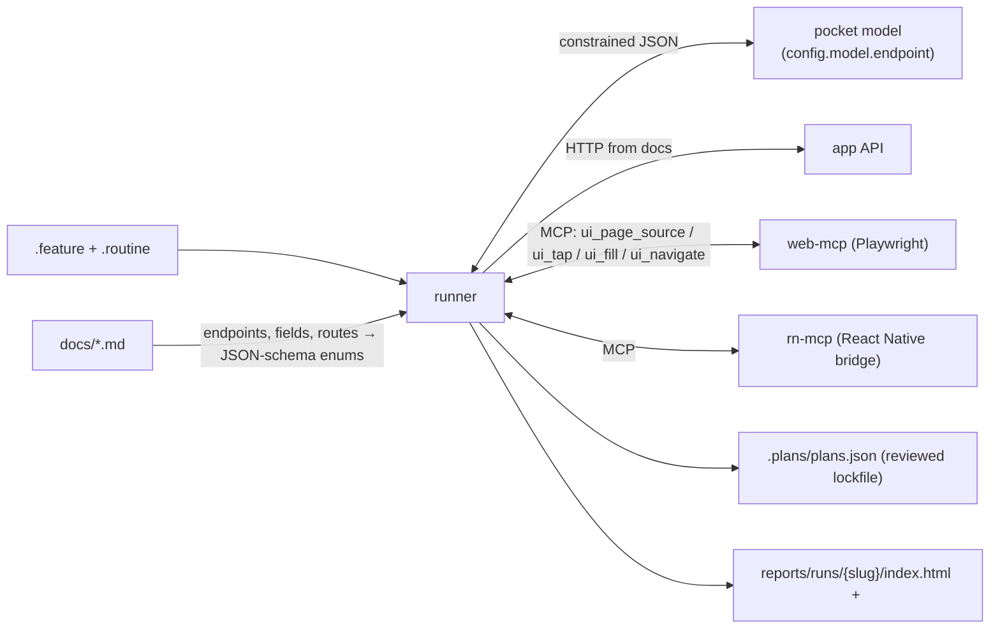

# @pn/e2e-ai — plain-language E2E for web and mobile, planned by a phone-class model

Developers write **only**:

| File | What it is |
|---|---|
| `e2e/features/*.feature` | Gherkin, plus `#tags` (a comment is `# text`), `@routine` calls, several `Background:` blocks (each applies to the scenarios below it) |
| `e2e/routines/*.routine` | Reusable human-language step groups: `Routine: create user "${email}" … ${table:notes[title, description]}`, nested `@routine` calls, `each ${table:x}` loops |
| `e2e/docs/*.md` | API reference (`### METHOD /path` + a `Field` table; GraphQL `### MUTATION name` / gRPC `### RPC svc/Method` headings are recognised) and an app guide (Routes table, "Before every scenario", Glossary, Examples) |
| `e2e/e2e-ai.config.json` | Model endpoint, docs, API base URL, MCP driver servers per target, report folders |
| `e2e/reports/templates/*.html` | Report templates — also the model's brief for laying out the report |

No step definitions, no TypeScript context. The **pocket model** (default `qwen3-vl:4b-instruct-q4_K_M`, the benchmark winner; any OpenAI-compatible
endpoint: llama.cpp `llama-server`, Ollama `/v1`, vLLM, LM Studio) reads the docs and plans every step;
**MCP servers** drive the apps; deterministic code checks everything the model says.



## Commands

```bash
npm run api & npm run notes:web &           # the sample app + its API (dev)
npm run e2e:ai:doctor                       # docs parse? model reachable? MCP drivers answer?
npm run e2e:ai:web                          # plan new steps with the model, run, write plans + report
npm run e2e:ai:web:replay                   # CI: no model, replay reviewed plans (fails on a cache miss)
PN_SIM=<udid> npm run e2e:ai:ios:replay     # same plans on the iOS simulator via the RN MCP server
npm run e2e:ai -- … --tags "#smoke,!#slow"  # tag filter
npm run e2e:ai:report -- e2e/reports/runs/<slug> --template executive   # re-render a run
```

## What the model may and may not do

- **May**: choose actions from a closed set, endpoints/routes from the docs (enums), elements from the
  page source (ties only), a report layout from a template's options, and report prose.
- **May not**: decide whether a test passed (assertions are deterministic checks on the page source),
  call anything undocumented, invent values (every value must appear in the step, a routine argument or
  an earlier API response), or state numbers/names/files that are not in the run data (rejected, with a
  generated fallback). Guards and their reasons: `docs/20261118-e2e-ai-cucumber-small-models/`.

## Report templates

`e2e/reports/templates/<name>.html` contains:

- `<script type="text/x-e2e-ai-brief">` — who reads it and what matters (the model's prompt);
- `data-section="…"` elements (`data-required` never hidden, `data-pinned` keeps its position);
- `data-e2e-ai-group-options="feature,tag,…"` — groupings the template can render;
- `data-ai="<slot>" data-ai-prompt="…"` — prose the model writes (`data-ai-each="failure"` per failure);
- `const DATA = /*__REPORT_DATA__*/null;` — where the run data (incl. `ai.view`, the chosen layout) lands.

Every run renders all templates: the default one as `index.html`, the others as `<name>.html`.

## Pieces

| File | Role |
|---|---|
| `src/dialect.ts`, `src/gherkin.ts` | `#tags`, `@routine` lines, per-Background groups → official Cucumber parser |
| `src/routineSyntax.ts`, `src/routines.ts` | routine parsing/matching (shared with the VS Code extension), expansion |
| `src/docs.ts` | Markdown → endpoints, routes, examples; HTTP execution |
| `src/config.ts`, `src/llm.ts` | config file; OpenAI-compatible / Ollama clients with JSON-schema output |
| `src/planner.ts`, `src/grounder.ts` | step → actions (constrained) + guards; target → element |
| `src/runner.ts`, `src/cache.ts` | execution, polling, healing, plan lockfile |
| `src/mcp/*` | MCP driver servers (`web-mcp.ts`, `rn-mcp.ts`) and the MCP client driver |
| `src/report.ts` | data → template; view plan + checked prose |
| `src/bench.ts`, `src/benchmark.ts` | labelled-step planner scoring; model benchmark data, modes, memory probe |
| `src/playwright.ts` | Playwright Test integration (`@pn/e2e-ai/playwright`) |
| `src/drivers/{appium,maestro,playwrightMcp}.ts` | Appium, Maestro and Playwright MCP integrations |
| `templates/` | default report templates (`e2e-ai init` copies them) |
| `../e2e-ai-cli` | the `e2e-ai` command (moved out of this package) |
| `../vscode-e2e-ai` | VS Code extension for `.feature` / `.routine` |
